# Sleep Stage Classification of NFLE Patients

This repository explores automatic sleep-stage classification for patients with nocturnal frontal lobe epilepsy (NFLE). It combines EDF/EEG recordings, expert R&K sleep-stage annotations, 30-second preprocessing, visualization, and deep-learning experiments.

The published study is [A Deep Convolutional Neural Network Based Classification Approach for Sleep Scoring of NFLE Patients](https://doi.org/10.1007/978-3-030-93247-3_35). The [ResearchGate record](https://www.researchgate.net/publication/357502032_A_Deep_Convolutional_Neural_Network_Based_Classification_Approach_for_Sleep_Scoring_of_NFLE_Patients) is also available. The paper PDF is not stored in this repository.

## Dataset

The source is the public [CAP Sleep Database (CAPSLPDB)](https://physionet.org/content/capslpdb/1.0.0/) on PhysioNet.

- 108 polysomnographic recordings in the full database
- 40 NFLE subjects in the database
- Subjects aged 14-67
- The paper focused on 15 of these subjects
- Six EEG channels are used:
  `ROC-LOC`, `FP2-F4`, `F4-C4`, `F7-T3`, `F3-C3`, and `T4-T6`
- Each EDF is sampled or resampled to 256 Hz
- Scoring follows R&K rules and uses six reported stages: Wake, R, S1, S2, S3, and S4
- [Gender and age demographics](./docs/demographics/gender-age.pdf): 21 male and 19 female subjects, ages 14-67

Raw EDF files are not all included in this repository. Download the required recordings and annotations from PhysioNet before running EDF-dependent scripts.

## Important project figures

### Project flow diagram

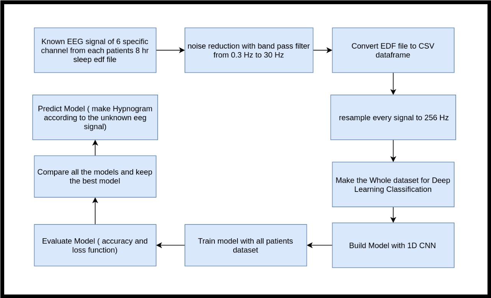

### Raw EDF signal

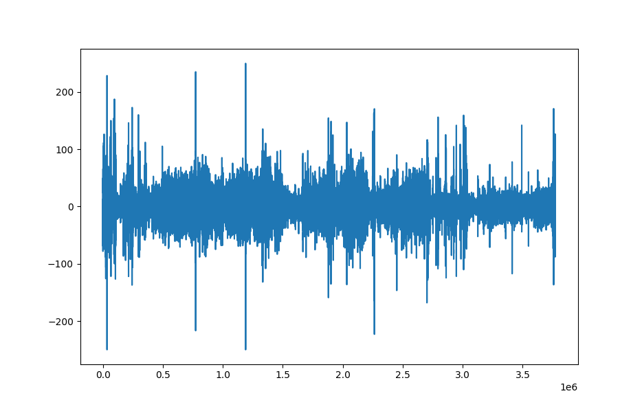

*The raw EEG signal visualization used during exploratory analysis.*

### Subject sleep-stage results

| NFLE10 | NFLE23 |
|---|---|
| 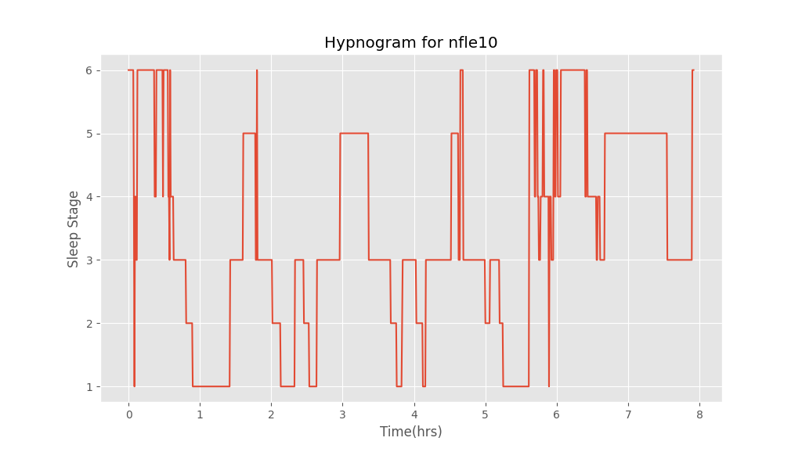 | 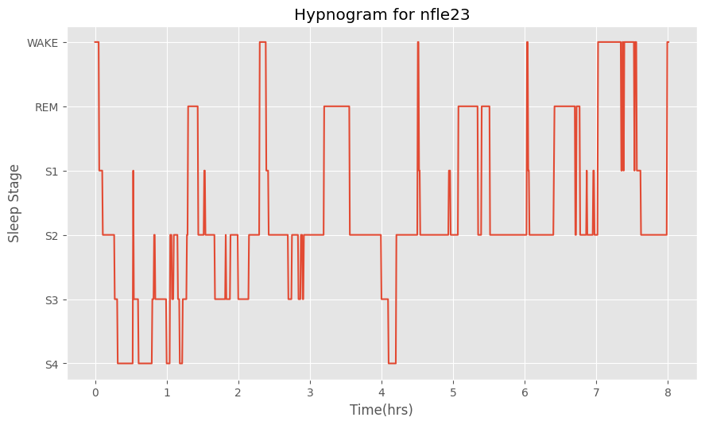 |
| 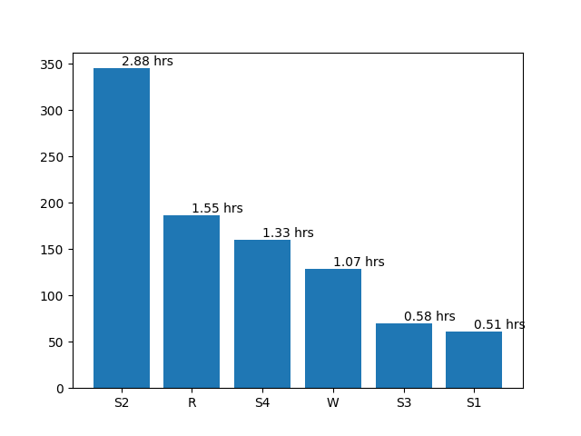 | 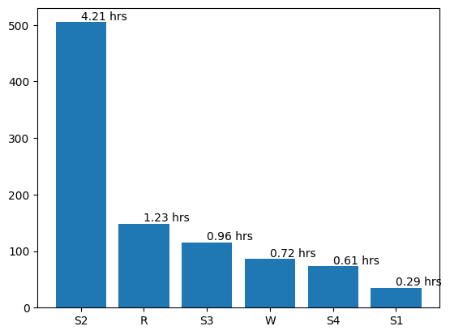 |

| NFLE4 | NFLE36 |
|---|---|
| 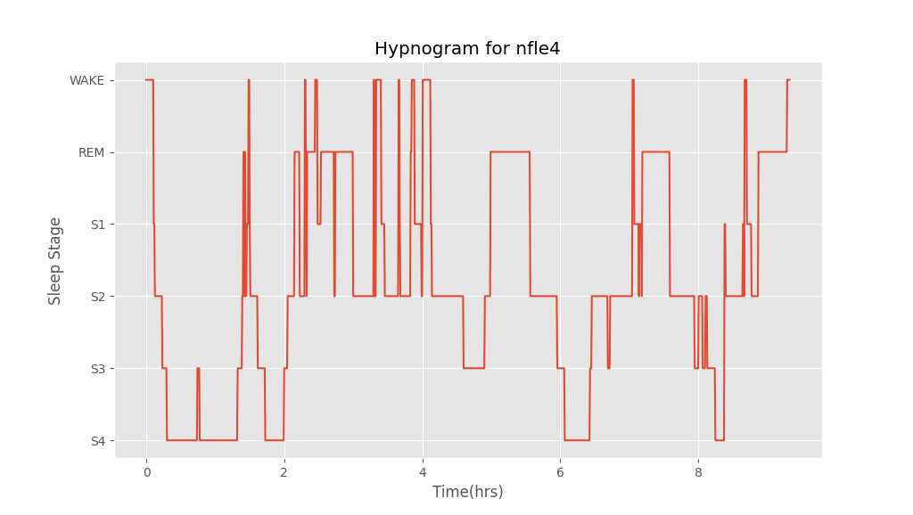 | 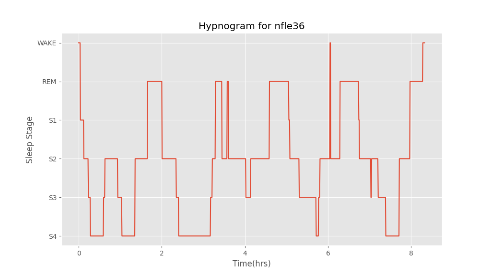 |
| 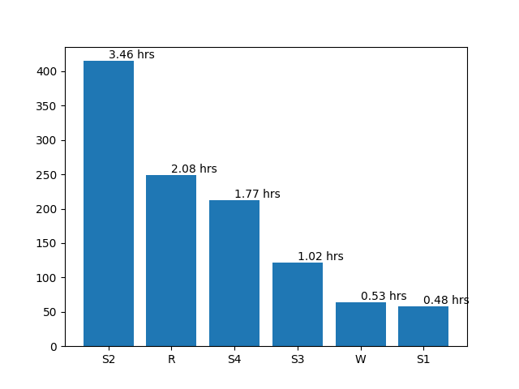 | 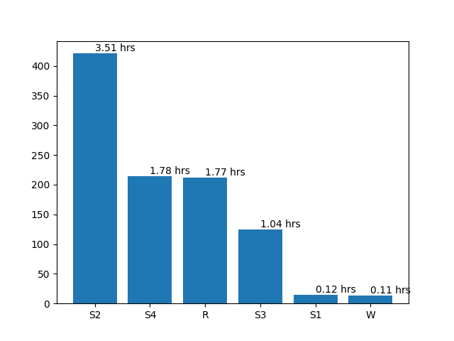 |

The hypnograms show each subject's sleep stages across approximately eight hours. The bar graphs show the distribution of those stages.

### NFLE and normal-subject comparisons

| Five-NFLE average | Five-normal average |
|---|---|
| 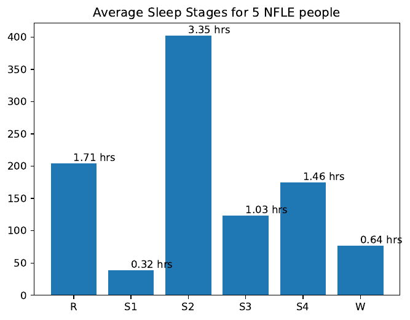 | 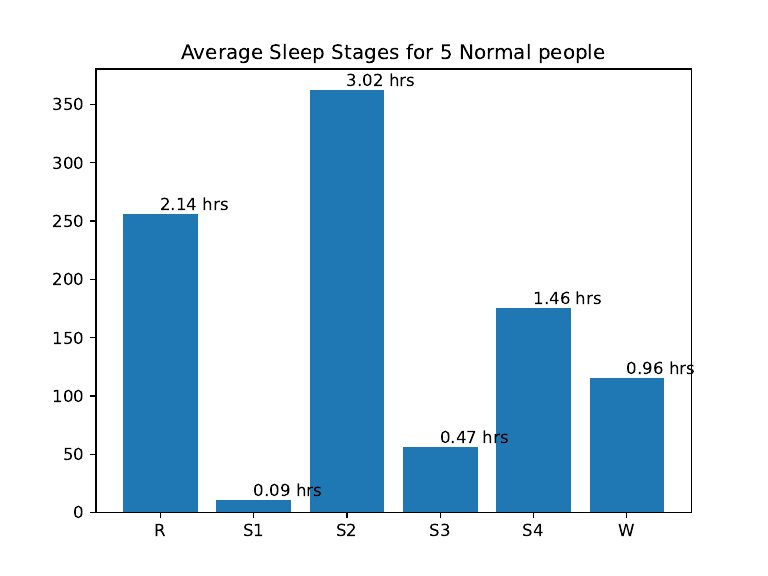 |

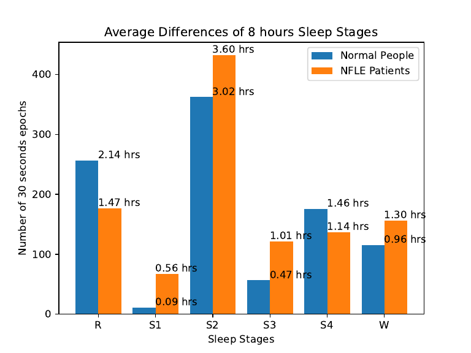

The preprocessing unit in the paper is a 30-second sleep epoch:

```text
256 Hz × 30 seconds = 7680 samples per epoch
Input shape: (7680, 6)
```

Timestamp discrepancies between EDF recordings and annotation files are resolved by trimming unscored EDF data and creating continuous 30-second annotation epochs. EDF files with 512 Hz sample rates are downsampled to 256 Hz.

## Model from the paper

The proposed deep model uses four Conv1D and pooling blocks, followed by flattening and fully connected layers.

| Layer | Output shape | Parameters |
|---|---:|---:|
| Conv1D | (7678, 64) | 1,216 |
| MaxPooling1D | (2559, 64) | 0 |
| Conv1D | (2557, 128) | 24,704 |
| MaxPooling1D | (852, 128) | 0 |
| Conv1D | (850, 256) | 98,560 |
| MaxPooling1D | (283, 256) | 0 |
| Conv1D | (281, 512) | 393,728 |
| MaxPooling1D | (93, 512) | 0 |
| Flatten | (47616,) | 0 |
| Dense | (128,) | 6,094,976 |
| Dense | (64,) | 8,256 |
| Dropout | (64,) | 0 |
| Dense output | (6,) | 390 |

**Total: 6,621,830 trainable parameters**

| Hyperparameter | Paper configuration |
|---|---|
| Optimizer | Adam |
| Loss | Categorical cross-entropy |
| Batch size | 32 |
| Epochs | 50 |
| Learning rate | 1e-4 |
| Activation | ReLU and Softmax |
| Output nodes | 6 |
| Input | `(7680, 6)` |

The reported result in the paper is **60.46% accuracy for 15 NFLE subjects**. The authors noted lower performance than ideal and attributed it to variability in individual sleep cycles and CAP patterns.

## Repository layout

### Raw and generated data

- `annotations/`: cleaned and raw annotation CSV/TXT files used by the plotting and preprocessing scripts
- `assets/hypnograms/`: per-subject sleep-stage timeline images
- `assets/bar_graphs/`: per-subject stage-duration images
- `assets/group_comparisons/`: normal versus NFLE comparison PDFs
- `assets/flow_diagrams/`: project system diagram
- `assets/raw_signals/`: raw EDF signal plots
- `docs/demographics/`: subject gender and age PDF

### Source code

Python scripts are organized by responsibility under `src/`:

- `src/data_ingestion/`: EDF loading and exploratory signal inspection
  - `mne_edf_to_csv.py`, `edfRead_analyse_with_mne.py`, `mne01.py`, `edfreader.py`
- `src/data_processing/`: annotation parsing, timestamp correction, target creation, reshaping, and dataset assembly
  - `txt_to_target_shamim.py`, `txt_check.py`, `time_calc.py`, `data_to_3d_image.py`, `rearrange_dataset.py`, `making_csv.py`, `preparing_dataset_test.py`, `cap-sleep-target-data.py`
- `src/visualization/`: hypnograms, bar graphs, and normal/NFLE comparisons
  - `annotations_to_hypnogram.py`, `mean_bar_graph.py`, `mean_bar_dual_graph.py`
- `src/models/`: deep-learning prototypes
  - `lstm_model_for_nfle10.py`
- `src/experimental/`: exploratory notebooks
  - `sleep_stage_001.ipynb`

## Current implementation status

The repository contains preprocessing experiments and visual artifacts, but it is not yet a turnkey reproduction of the paper model:

- The Conv1D architecture and hyperparameters above are documented in the paper but are not fully implemented in the current model script.
- `src/models/lstm_model_for_nfle10.py` is a prototype LSTM, not the paper's four-block Conv1D classifier.
- No trained model weights or complete 15-subject evaluation results are stored in the repository.
- Several scripts use hard-coded paths and intermediate filenames.
- There is no dependency lock file or centralized configuration file.

Do not interpret the paper's 60.46% result as a verified result of the current LSTM prototype.

## Reproduce the visualizations

Annotation CSV and text files are enough to regenerate the subject plots:

```bash
python src/visualization/annotations_to_hypnogram.py --version 23
python src/visualization/mean_bar_graph.py --version1 1 --version2 4 --version3 5 --version4 8 --version5 39
```

Generated files are written beneath `assets/hypnograms/`, `assets/bar_graphs/`, and `assets/group_comparisons/`.

## Dependencies indicated by the scripts

```text
numpy
pandas
matplotlib
scikit-learn
mne
pyedflib
tensorflow
jupyter
```
